# Mappa generale del progetto — MagicIAedit

> Documento di riferimento operativo delle decisioni dell'utente e delle attività concordate. Da consultare prima di ogni nuovo blocco di sviluppo e aggiornare quando l'utente approva nuove funzioni o cambia una decisione.
>
> Repository: `damianoavvocato-star/editore-foto-video-ia`  
> Branch di lavoro: `feature/magiciaedit-cloud-foundation`  
> `main` resta intatto. APK soltanto nella fase 6, come ultimo passaggio.

## 1. Mappa visiva

```mermaid
flowchart TD
    A["MagicIAedit — Editore Foto e Video IA"] --> B["Prodotto e piattaforme"]
    A --> C["Esperienza creativa"]
    A --> D["Account e pannelli"]
    A --> E["Business e monetizzazione"]
    A --> F["Sicurezza e infrastruttura"]
    A --> G["Distribuzione e crescita"]
    A --> H["Piano di consegna"]

    B --> B1["Android · iPhone · Desktop"]
    B --> B2["Italiano · Inglese · Francese · Arabo · Spagnolo + lingue principali"]
    B --> B3["Free per funzioni base · Premium per funzioni avanzate"]

    C --> C1["Editor manuale foto/video"]
    C --> C2["MagicIAedit: montaggio automatico"]
    C --> C3["Studio IA: crea anche da prompt senza media"]
    C --> C4["Voce · sottotitoli · traduzione · doppiaggio"]
    C --> C5["Foto e video avanzati · export · condivisione"]

    D --> D1["Proprietario: controllo completo"]
    D --> D2["Amministratore: console separata e limitata"]
    D --> D3["Assistenza: ticket e accesso consensuale"]
    D --> D4["Collaboratore: TeamStudio e permessi"]
    D --> D5["Utente: account, progetti, Premium"]

    E --> E1["Premium · pagamenti · rinnovi"]
    E --> E2["Referral bilaterale: 1 mese a entrambi"]
    E --> E3["Crediti · quote · costi IA"]
    E --> E4["Famiglia Premium"]

    F --> F1["Autorizzazioni e isolamento account"]
    F --> F2["2FA · sessioni · reset password"]
    F --> F3["Audit verificabile · backup · privacy"]
    F --> F4["Job durevoli · retry · storage privato"]

    G --> G1["Social e pubblicazione"]
    G --> G2["AdCreator · brand kit · analytics con consenso"]
    G --> G3["Team · e-commerce · LMS/SCORM"]

    H --> H1["Fasi 1–5: implementazione, test, hardening"]
    H --> H2["Gate finale: verifica completa"]
    H --> H3["Fase 6: APK finale, ultima attività"]
```

## 2. Identità e decisioni che non vanno cambiate senza autorizzazione

- Nome del prodotto: **MagicIAedit — Editore Foto e Video IA**.
- La funzione di auto-montaggio si chiama **MagicIAedit**, non MagicCut.
- Prodotto multipiattaforma: Android, iPhone e computer.
- Esperienza multilingue: almeno italiano, inglese, francese, arabo e spagnolo, con estensione alle principali lingue usate nelle app.
- Modello commerciale deciso: funzioni di base gratuite; abbonamento Premium per strumenti e capacità più complesse.
- Referral deciso: un mese gratuito per chi invita e un mese gratuito per la persona invitata, dopo controlli antifrode e maturazione del referral.
- Tutti i video creati devono poter essere salvati e condivisi con social network o altre persone.
- L'utente deve poter ingrandire il video anche durante la riproduzione del risultato generato/esportato.
- Prevedere formati di esportazione comuni, inclusi MP4 e AVI, oltre agli altri formati supportati realmente dai codec.
- Non rinominare il prodotto, non sostituire MagicIAedit con MagicCut e non cambiare l'identità grafica approvata senza chiedere.
- La scorciatoia per le **ultime 2 foto** deve essere disponibile, ma non deve mai limitare l'accesso alla galleria completa.
- L'utente vuole che l'assistente proceda in blocchi ampi e autonomi dopo “Procedi/Prosegui”, evitando conferme ripetitive.
- L'utente usa soprattutto Android: preferire modifiche dirette al repository e ridurre al minimo le istruzioni manuali da Termux.
- Comunicare sempre con trasparenza limiti, test mancanti e dipendenze esterne. Mai dichiarare completata una funzione solo perché esiste una schermata o un endpoint.

## 3. Mappa delle funzioni del prodotto

### 3.1 Editor foto e video manuale
- Importazione di foto e video, selezione multipla, libreria media, progetti salvati e riaperti.
- Timeline multi-traccia, taglio, trim, split, riordino, transizioni, testo, titoli, sticker, filtri, effetti, audio, voiceover, musica e sottotitoli.
- Controlli avanzati da completare: keyframe, curve di velocità, maschere, tracking, chroma key, stabilizzazione, color grading, LUT/HDR, multicamera, proxy e anteprima fluida.
- Player con zoom durante playback; mantenere zoom anche sul video già esportato.
- Gestione font e fallback, inclusa corretta resa RTL per arabo.
- Esportazione con preset e formati realmente verificati (MP4, AVI, MOV, WebM e altri compatibili).
- Undo/redo, autosave, versioni, recupero progetti, gestione errori e risorse mancanti.
- Nessun pulsante deve restare un placeholder che dichiara una funzione disponibile.

### 3.2 MagicIAedit — auto-montaggio intelligente
- Deve poter analizzare le foto e i video selezionati, scegliere automaticamente i contenuti più adatti e creare una proposta di montaggio.
- Deve proporre ritmo, ordine, tagli, transizioni, musica, testi e stile, in base al contesto e all'obiettivo.
- L'utente deve sempre poter rivedere il risultato e poi salvarlo, modificarlo o pubblicarlo.
- La funzione deve essere richiamabile nelle schermate e nei contesti pertinenti dell'app, non confinata a una sola pagina.
- Quando si selezionano o cambiano foto/video, deve poter aggiornare la proposta IA in modo contestuale, senza sovrascrivere modifiche manuali non confermate.
- Servono provider reali, gestione credenziali lato server, costi, quote, errori, retry, cancellazione e consenso.
- Distinguere sempre tra analisi/piano locale e generazione cloud effettivamente eseguita.

### 3.3 Creazione da prompt senza foto o video
- L'utente può chiedere un contenuto completo anche senza caricare media.
- Esempio approvato come caso d'uso: “crea una miniserie romantica di 10 puntate, minimo un minuto per puntata”.
- Il sistema deve creare concept, personaggi, episodi, script, scene, storyboard, dialoghi, voci, media e montaggio, con continuità narrativa.
- L'utente deve poter modificare ogni episodio/scena e approvare prima della generazione o pubblicazione.
- Non confondere una scaletta/template con la generazione completa dei 10 episodi.
- Prevedere AI Director/MagicIA Brain, memoria creativa del progetto, varianti, revisione scene e continuità dei personaggi.

### 3.4 Universal Creative Studio
- Tipi di progetto richiesti: script-to-video, document-to-video, slides-to-video, avatar video, talking photo, translate/dub, interactive video, bulk personalization, screen explainer.
- Bozze, anteprima, revisione, consenso, invio esplicito alla coda, stato, retry, annullamento e storico.
- Nessun provider deve essere dichiarato operativo senza configurazione e chiamata di prova.
- La coda e le bozze già implementate costituiscono una base, non prova che i video siano già generati realmente.

### 3.6 MagicLink IA — link universali e serie da tradurre
- L'utente può incollare o condividere un URL da siti e piattaforme supportati e descrivere in linguaggio naturale il risultato desiderato.
- Il sistema riconosce piattaforma e tipo di contenuto quando le informazioni sono accessibili; deve mostrare con chiarezza cosa è stato effettivamente letto e cosa non è accessibile.
- Per le serie: individuazione degli episodi accessibili, elenco ordinato, selezione di una o più puntate e lavorazione batch con stato, retry e annullamento.
- Azioni previste: trascrizione, traduzione dei sottotitoli, doppiaggio, riassunto e apertura del materiale in MagicIAedit per il montaggio.
- Il contenuto remoto può essere elaborato solo tramite accessi, API o importazioni autorizzate e nel rispetto dei termini della piattaforma, dei diritti e del consenso. Se un link non è leggibile, proporre l'importazione di un file che l'utente è autorizzato a utilizzare.
- Mai aggirare login, DRM, paywall, protezioni tecniche o limitazioni di accesso. Nessuna promessa di compatibilità universale: dichiarare i limiti per ogni piattaforma.
- UI Flutter disponibile nella navigazione: incolla da appunti, istruzione in linguaggio naturale e presentazione dello stato di riconoscimento. Backend in modalità metadata-only: non scarica né analizza ancora i media. Connettori di estrazione autorizzata, elenco episodi e provider ASR/traduzione/TTS restano da implementare.

### 3.5 Audio, voce, lingue e sottotitoli
- ASR/trascrizione con timestamp e, quando disponibile, diarizzazione speaker.
- Traduzione segmentata, glossario e controllo qualità.
- TTS, voci, voiceover, doppiaggio, sincronizzazione labiale e talking photo, nel rispetto dei consensi e dei diritti.
- Sottotitoli SRT/VTT/ASS importabili ed esportabili e collegati alla timeline.
- OCR per testi visibili nei video e sostituzione testi dove tecnicamente possibile.
- Batch di localizzazione per molte lingue, anche 20+, con output separati, ZIP, retry e verifica.
- Interfaccia localizzata in tutte le lingue previste, non soltanto alcune stringhe; arabo con layout RTL corretto.

### 3.6 Strumenti foto e video IA avanzati
- Foto: restauro, colorizzazione, rimozione oggetti, rimozione/sostituzione sfondo, ritocco, prospettiva, movimento 3D e ricerca foto simili.
- Video: denoise, enhancement, upscaling, interpolazione frame, stabilizzazione, rilevamento scene, trascrizione modificabile e creazione clip brevi.
- Copertine, titoli, descrizioni e metadati suggeriti automaticamente ma sempre revisionabili.

## 4. Mappa dei ruoli e dei pannelli

### Proprietario
- Console autonoma con dashboard e statistiche reali.
- Gestione account, ruoli, permessi, sospensione/riattivazione e reset password.
- Gestione Premium: concessioni, estensioni, revoche, famiglia, quote e crediti.
- Configurazione provider IA, feature flags, limiti, costi e stato servizi.
- Audit consultabile, filtrabile, esportabile e con protezione antimanomissione.
- Gestione segnalazioni, ticket, diagnostica, code, backup, ripristino e stato infrastruttura.
- Può avere controllo completo; proteggere comunque gli account e le sessioni.

### Amministratore
- Console distinta da quella Proprietario, con permessi operativi limitati.
- Gestione utenti e collaboratori solo nei limiti autorizzati.
- Consultazione abbonamenti, ticket, segnalazioni e diagnostica secondo policy.
- Non può creare o promuovere un Proprietario, modificare il Proprietario, elevarsi i privilegi o accedere a progetti/file privati senza consenso.
- Tutte le azioni sensibili devono essere autorizzate dal backend e registrate.

### Assistenza
- Console ticket con assegnazione, risposta, priorità, stato, escalation e cronologia.
- Accesso assistito a progetti/file solo con consenso esplicito, limitato nel tempo e auditato.
- Nessuna lettura indiscriminata di contenuti privati.

### Collaboratore
- TeamStudio con inviti, incarichi, progetti condivisi, commenti, revisioni, approvazioni, versioni e revoca.
- Permessi granulari per progetto e ruolo.
- Nessun accesso implicito a contenuti non condivisi.

### Utente
- Account, sicurezza, progetti, libreria media, esportazioni, condivisione, Premium, referral e famiglia.
- Controllo dei consensi, privacy, dati, sessioni e cancellazione.

## 5. Account, Premium e modello economico
- Collegare realmente le schermate Premium alla navigazione; le voci “Premium” e “Invita” non devono aprire genericamente l'editor.
- Integrare acquisti e abbonamenti per store mobile e web: validazione ricevute, webhook, rinnovi, cancellazioni, rimborsi, cronologia e sincronizzazione entitlement.
- Definire matrice Free/Premium per ogni funzione, limiti e quote, visibili e applicati dal backend.
- Referral bilaterale: mese gratuito a entrambe le persone, attribuzione affidabile, antifrode, regole di maturazione, storico e revoca in caso di abuso.
- Premium famiglia: inviti, posti, limiti, uscita e revoca.
- Crediti IA e costi: ledger idempotente, saldo, limiti per utente e controlli anti doppio addebito.
- Grant Premium manuali da console Proprietario, con motivazione, scadenza e audit.

## 6. Sicurezza, privacy e affidabilità
- Autorizzazione lato backend per ogni operazione; UI non è una barriera di sicurezza.
- Isolamento account per progetti, media, asset, download, export, queue e storage cloud.
- 2FA per Proprietario e valutazione/enforcement per Admin e Assistenza; recovery sicuro.
- Password temporanee con scadenza (implementazione iniziale 24 ore già aggiunta; mantenere test e migrazioni).
- Sessioni revocabili, audit e protezione da escalation privilegi.
- Audit antimanomissione e verifiche di integrità.
- Storage privato, URL firmati a scadenza, cifratura, retention e cancellazione.
- Backup e restore verificati; cestino e versioning dove appropriato.
- Job durevoli: riavvio, lease, retry, resume, idempotenza e nessun doppio addebito.
- SafeMedia protetto da PIN/biometria dove disponibile.
- Rimozione metadati GPS su richiesta/secondo impostazioni; Privacy Director e controlli privacy.
- Diagnostica e telemetria minimizzata, trasparente e con consenso quando necessario.

## 7. Marketing, collaborazione e distribuzione
- AdCreator, materiali promozionali, brand kit e template.
- MultiSocial: collegamento canali, programmazione e pubblicazione con OAuth sicuro e consenso.
- Player incorporabile e link di condivisione con permessi/scadenza.
- Analytics rispettose della privacy e opt-out.
- Contenuti e-commerce, personalizzazione massiva e bulk video.
- LMS/SCORM per contenuti formativi.
- TeamStudio e flussi di approvazione.
- Build e test distinti per Android, iOS, Windows, macOS e Linux; non dichiarare un target pronto senza build/installazione verificata.

## 8. Sequenza di lavoro concordata: 6 fasi

La numerazione è una sequenza di controllo, non una promessa di completamento basata su percentuali non verificate.

1. **Fase 1 — Fondamenta e architettura:** repository, struttura app/backend, modelli, navigazione, account, sicurezza di base e CI.
2. **Fase 2 — Editor e media:** importazione, timeline, strumenti manuali, rendering, player, export e gestione progetti.
3. **Fase 3 — IA e Studio:** MagicIAedit, prompt senza media, pipeline IA, bozze/coda, voce, traduzione e generazione reale tramite provider.
4. **Fase 4 — Account, pannelli e business:** Proprietario, Amministratore, Assistenza, Collaboratore, Premium, pagamenti, referral, crediti e famiglia.
5. **Fase 5 — Hardening e completezza:** sicurezza, privacy, isolamento, backup, recovery, localizzazione, test estesi, accessibilità, marketing e verifica multipiattaforma.
6. **Fase 6 — APK finale:** solo dopo il completamento e la verifica delle fasi precedenti; creazione APK come ultima fase. Non anticipare APK per comodità o per far sembrare il progetto più avanti.

## 9. Regole operative per ogni sessione di sviluppo
1. Prima leggere il codice e lo stato CI attuali; non presumere che il repository sia rimasto invariato.
2. Lavorare su `feature/magiciaedit-cloud-foundation`; non modificare `main` e non fare merge della PR senza autorizzazione esplicita.
3. Procedere in batch ampi: analisi, implementazione, test, correzione, verifica CI e aggiornamento documentazione.
4. Dopo “Procedi/Prosegui”, continuare il prossimo blocco senza chiedere conferma per modifiche non distruttive già autorizzate.
5. Se serve una credenziale, approvazione esterna, acquisto o accesso che l'assistente non possiede, fermarsi solo su quel passaggio e spiegare il minimo intervento richiesto. Non chiedere password, token o codici 2FA in chat.
6. Ogni funzione deve avere criteri di accettazione e test positivi, negativi, autorizzazione e isolamento.
7. Per Flutter: unit/widget test e `flutter analyze`; per backend: pytest, test API e sicurezza.
8. Aggiornare `docs/MASTER_FEATURE_REGISTER.md` con stato e prove; questo documento è la mappa delle decisioni e dei rami funzionali.
9. Distinguere sempre implementato, parziale, mancante e bloccato. Non contare schermate placeholder come funzioni finite.
10. Comunicare i risultati verificati con commit, run CI e link, senza inventare percentuali o test.
11. Non creare APK prima della fase 6. Il preflight Android può controllare Gradle senza produrre APK.
12. Se una nuova richiesta modifica una decisione, aggiornare prima questa mappa e poi il registro funzionale.

## 10. Stato di partenza documentato
- Il registro funzionale `docs/MASTER_FEATURE_REGISTER.md` contiene 57 voci di lavoro nel primo inventario.
- Password temporanee: implementata scadenza a 24 ore con test aggiunti.
- Ultima verifica CI osservata durante il lavoro: 300 test backend superati, 139 test Flutter superati e analisi statica superata; Android preflight era ancora in esecuzione in quel momento. Ricontrollare il run prima di dichiarare lo stato attuale.
- La base Studio IA supporta bozze e coda con invio esplicito, ma il provider di generazione non è ancora abilitato.
- I pannelli di ruolo avevano una prima etichettatura e controlli, ma non erano ancora console autonome complete.
- Nessun APK finale è stato generato in questa fase.

## 11. Collegamenti interni
- Registro verificabile delle singole funzioni: `docs/MASTER_FEATURE_REGISTER.md`.
- Audit approfondito: `docs/FEATURE_AUDIT_2026-11-08.md`.
- Roadmap e aree di sviluppo: `docs/DEVELOPMENT_PLAN_50_AREAS.md` e `docs/ROADMAP_FUTURE_FEATURES.md`.
- Sicurezza: `docs/SECURITY_OPERATIONS.md` e `docs/ACCOUNT_AUTH_FOUNDATION.md`.
- Studio IA: `docs/STUDIO_JOB_ORCHESTRATION.md`, `docs/SYNTHESIA_PROVIDER_INTEGRATION.md`.
- Branding e operazioni: `docs/MAGICIAEDIT_BRANDING.md`, `docs/MAGICIAEDIT_OPERATIONS.md`.

## 12. Regola concordata: sviluppo e test per soglie del 5%

A partire dal 10 novembre 2026, il lavoro segue un ciclo a soglie:
- Da **32,76%** fino a **34,99%**: soltanto sviluppo, integrazione e documentazione. Niente test automatici, analisi statica o preflight.
- A **35%, 40%, 45%, 50%** e poi ogni 5 punti fino al **100%**: una campagna completa di verifica e correzione di tutti i problemi rilevati.
- Tra una soglia e la successiva: solo sviluppo, senza ripetere i test.
- Il progresso è calcolato sulle funzionalità effettivamente implementate secondo i criteri del registro, non sul numero di schermate o righe di codice. Le funzionalità non testate non vengono marcate `done`.
- GitHub Actions non deve avviare i job di test su ogni commit/PR. La campagna completa si avvia manualmente impostando `run_full_validation=true` nel workflow **Flutter checks**.
- Il job APK resta separato e non deve essere abilitato prima della fase 6.

La prossima campagna autorizzata è al **35,00%**. La percentuale generale corrente resta **32,76%** fino a un aggiornamento sostenuto da nuove funzionalità completate; nessun test viene anticipato per inseguire la soglia.
